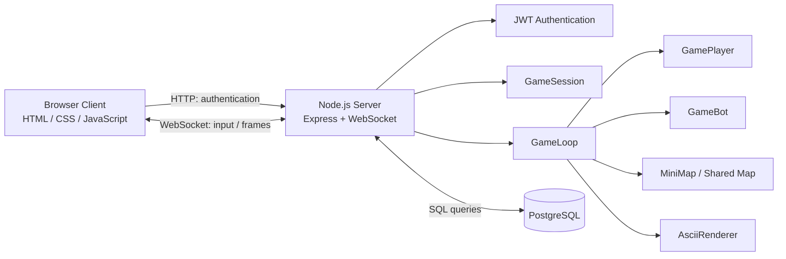

# Shooter — ASCII Multiplayer FPS

A real-time, browser-based ASCII first-person shooter built with Node.js, TypeScript, Express, WebSockets, and PostgreSQL.

This project is a Node.js/TypeScript port of the original [Shooter C# project](https://github.com/paveldsh1/Shooter).

**Repository:** [Shooter-Node-Express-TS-PostgresSQL-](https://github.com/paveldsh1/Shooter-Node-Express-TS-PostgresSQL-)

## Features

- **WebSocket multiplayer** — multiple players share the same game world.
- **ASCII raycasting renderer** — first-person perspective, wall depth calculations, enemy sprites, weapon overlays, and minimap.
- **Random map generation** — connected walkable areas and wall collision detection.
- **Player movement** — forward/backward movement and rotation.
- **Weapon system** — pistol and shotgun with different cooldowns, damage, range, and hit angles.
- **Server-side combat** — hit detection checks distance, aiming angle, and wall obstruction.
- **Health and respawning** — players take damage, die, and respawn after a delay.
- **Moving bots** — AI-controlled opponents that move around the map and can be shot.
- **Bot mode toggle** — press `9` to enable or disable bot mode.
- **Minimap and help overlay** — press `M` to toggle the minimap and `Enter` to toggle help.
- **JWT authentication** — authenticated WebSocket connections.
- **PostgreSQL persistence** — player accounts and saved player state.
- **Browser client** — HTML, CSS, and vanilla JavaScript; no frontend framework required.
- **Docker Compose** — run the game server and PostgreSQL together.

## Quick Start with Docker

Docker is the only runtime prerequisite. You do not need to install Node.js, Yarn, or PostgreSQL separately.

### Requirements

- [Docker Desktop](https://www.docker.com/products/docker-desktop/) on Windows or Docker Engine with the Compose plugin on Linux.
- Git.

### 1. Clone the repository

```bash
git clone https://github.com/paveldsh1/Shooter-Node-Express-TS-PostgresSQL-.git
cd Shooter-Node-Express-TS-PostgresSQL-
```

### 2. Configure environment variables

Create a `.env` file in the project root. Use `.env.example` as a template if one is provided.

For local development, the environment file should contain:

```dotenv
PORT=3000
JWT_SECRET=replace_this_with_a_long_random_secret
JWT_EXPIRES_IN=5h
POSTGRES_PASSWORD=local_dev_password
```

Replace the example JWT secret with a long, randomly generated value before running the application beyond local testing.

**Important:** Never commit `.env` or publish real secrets. The Compose configuration supplies the database connection settings to the game container. Inside Docker, the database hostname must be `postgres`, not `127.0.0.1`.

### 3. Start the game

From the project root, run:

```bash
docker compose up -d --build
```

Docker Compose builds the game image, starts PostgreSQL, waits for the database health check, and starts the game server.

The first launch requires an internet connection to download the base images and dependencies. Subsequent launches can reuse cached images and packages.

### 4. Open the game

Open your browser at:

**http://localhost:3000**

To check the status of the containers:

```bash
docker compose ps
```

To view the game server logs:

```bash
docker compose logs -f game
```

To stop the services:

```bash
docker compose stop
```

To stop and remove the containers while preserving database volumes:

```bash
docker compose down
```

**Warning:** `docker compose down -v` removes the Compose-managed database volumes and may permanently delete saved player data.

## Gameplay

The game renders a first-person ASCII view in the browser. The server manages movement, collision detection, weapon cooldowns, hit detection, health, bots, and respawning.

Connected players share the same world and can see each other in real time. Shooting is processed on the server, and walls block shots.

When a player dies, the server schedules a respawn after three seconds. The player's health is restored on respawn. Saved player position and orientation can be restored from PostgreSQL when available.

Bot mode adds moving AI-controlled opponents. Bots navigate walkable areas, have health, can be shot, and respawn after being killed. Bots do not attack players.

## Controls

| Key | Action |
|---|---|
| `W` | Move forward |
| `S` | Move backward |
| `A` | Turn left |
| `D` | Turn right |
| `Space` | Shoot |
| `1` | Select pistol |
| `2` | Select shotgun |
| `9` | Toggle bot mode |
| `M` | Toggle minimap |
| `Enter` | Toggle help overlay |

## Weapons

### Pistol

- Faster firing rate.
- Longer effective range.
- Narrower hit angle.
- Damage per hit: `25`.

### Shotgun

- Longer firing cooldown.
- Shorter effective range.
- Wider hit angle.
- Damage per hit: `15`.

The server checks the target's distance and angle relative to the shooter and verifies that no wall blocks the shot.

## Tech Stack

| Component | Technology |
|---|---|
| Runtime | Node.js 20 |
| Language | TypeScript |
| HTTP server | Express |
| Real-time communication | WebSocket (`ws`) |
| Database | PostgreSQL |
| Database access | `pg`, direct SQL queries |
| Authentication | JSON Web Tokens (JWT) |
| Frontend | HTML, CSS, vanilla JavaScript |
| Package manager | Yarn 4 |
| Containerization | Docker and Docker Compose |

## Architecture



## Backend Modules

| File | Responsibility |
|---|---|
| `src/server.ts` | HTTP/WebSocket server, authentication, database initialization, player connections |
| `src/db.ts` | PostgreSQL connection and table initialization |
| `src/game/game-session.ts` | Per-connection game state, keyboard input, weapon selection, and interface settings |
| `src/game/game-loop.ts` | Game updates, rendering, combat, hit detection, and respawning |
| `src/game/player.ts` | Player position, movement, collisions, health, and respawning |
| `src/game/bot.ts` | Bot movement, health, target selection, and respawning |
| `src/game/mini-map.ts` | Random map generation, connectivity checks, walkability, and spawn selection |
| `src/game/ascii-renderer.ts` | Raycasting, wall depth, enemy rendering, minimap, weapon overlay, and help text |
| `src/game/enemy-sprites.ts` | ASCII enemy sprites |
| `src/game/weapon-sprites.ts` | Weapon sprites and weapon types |
| `public/index.html` | Browser client, authentication UI, keyboard input, WebSocket connection, and frame display |

## Game Loop and Rendering

The game loop runs approximately every `50 ms`, targeting around **20 frames per second**.

Each frame:

1. Updates active bots.
2. Iterates through connected WebSocket sessions.
3. Collects snapshots of other living players and active bots.
4. Raycasts the map to calculate wall distances.
5. Renders enemies, the minimap, the selected weapon, and help overlays.
6. Sends the ASCII frame to the client as a binary WebSocket message.

The server remains responsible for the authoritative game state and combat calculations.

## WebSocket Protocol

### Client → Server

The browser sends keyboard event codes such as:

- `KeyW`, `KeyA`, `KeyS`, `KeyD`
- `Space`
- `Digit1`, `Digit2`, `Digit9`
- `KeyM`
- `Enter`

The client also sends viewport updates in this format:

```text
RESIZE {columns} {rows} {scale}
```

### Server → Client

The server sends rendered ASCII frames as binary WebSocket messages. The browser displays the received frames in the game interface.

The WebSocket connection uses the authentication protocol configured by the client and server.

## Database and Persistence

PostgreSQL stores player account information and saved game state. The application uses the `pg` package and direct SQL queries without an ORM.

The schema includes:

- `players` — player IDs, nicknames, password hashes, and creation timestamps.
- `player_states` — saved player position, orientation, and last update time.

The application creates these tables automatically during startup if they do not exist.

Docker Compose stores database files in a named volume so that saved data survives ordinary container restarts and `docker compose down`.

**Back up the database volume before removing volumes, resetting the database, or performing migrations.**

## Running Locally Without Docker

For development, install Node.js 20 or later, Git, Yarn 4, and PostgreSQL.

### 1. Clone the repository

```bash
git clone https://github.com/paveldsh1/Shooter-Node-Express-TS-PostgresSQL-.git
cd Shooter-Node-Express-TS-PostgresSQL-
```

### 2. Install dependencies

```bash
yarn install
```

### 3. Configure PostgreSQL

Create a database and user, then configure the environment variables expected by the application.

Typical local settings:

```dotenv
PORT=3000
JWT_SECRET=replace_this_with_a_long_random_secret
JWT_EXPIRES_IN=5h
DB_HOST=127.0.0.1
DB_PORT=5432
DB_USER=app
DB_PASSWORD=local_dev_password
DB_NAME=player_state
```

These values are examples for local development. Use a strong random JWT secret and a secure database password in any shared or public environment.

### 4. Build the project

```bash
yarn build
```

To run the development server, if the `dev` script is configured:

```bash
yarn dev
```

Open [http://localhost:3000](http://localhost:3000).

## Environment Variables

| Variable | Purpose |
|---|---|
| `PORT` | HTTP server port |
| `JWT_SECRET` | Secret used to sign and verify JWTs |
| `JWT_EXPIRES_IN` | JWT expiration interval |
| `DB_HOST` | PostgreSQL hostname; use `postgres` in Docker Compose and `127.0.0.1` for local development |
| `DB_PORT` | PostgreSQL port |
| `DB_USER` | PostgreSQL username |
| `DB_PASSWORD` | PostgreSQL password |
| `DB_NAME` | PostgreSQL database name |
| `POSTGRES_PASSWORD` | Password configured for the PostgreSQL container by Docker Compose |

The exact variables passed to each container are defined in `compose.yaml`. Keep that configuration and the application's environment variable names consistent.

## Security

- JWT-based authentication.
- Server-side game state and combat processing.
- Database credentials and authentication secrets configured through environment variables.
- PostgreSQL persistence using direct SQL queries.

For public deployment:

- Generate a strong, unique JWT secret.
- Use strong database credentials.
- Do not expose PostgreSQL to the public internet.
- Configure HTTPS/WSS through a reverse proxy or suitable hosting platform.
- Do not commit `.env` or other secret-bearing files.
- Consider rate limiting, input validation, database backups, and structured logging.

The development defaults are intended only for local testing, not production use.

## Design Principles

- **Separation of concerns** — player logic, bot logic, rendering, session management, and persistence are kept in separate modules.
- **Server-authoritative gameplay** — movement and combat state are processed on the server.
- **Shared world** — connected players and bots use the same map and rendering pipeline.
- **Direct SQL access** — database operations are performed without an ORM.
- **Typed contracts** — TypeScript types define game actions, viewport settings, and weapon types.
- **Lightweight client** — vanilla JavaScript communicates with the backend over HTTP and WebSocket.

## Project Structure

```text
Shooter-Node-Express-TS-PostgresSQL-/
├── public/
│   └── index.html
├── src/
│   ├── game/
│   │   ├── ascii-renderer.ts
│   │   ├── bot.ts
│   │   ├── enemy-sprites.ts
│   │   ├── game-loop.ts
│   │   ├── game-session.ts
│   │   ├── mini-map.ts
│   │   ├── player.ts
│   │   └── weapon-sprites.ts
│   ├── db.ts
│   └── server.ts
├── .dockerignore
├── .env.example
├── .gitignore
├── .yarnrc.yml
├── compose.yaml
├── Dockerfile
├── package.json
├── tsconfig.json
├── yarn.lock
└── README.md
```

This is the main project structure. Additional files may exist as the project evolves.

## Troubleshooting

### The game container exits

Inspect its logs:

```bash
docker compose logs --tail=100 game
```

### PostgreSQL is not ready

Check the database service:

```bash
docker compose ps
docker compose logs --tail=100 postgres
```

### Port 3000 is already in use

Stop the application using that port, or change the published host port in `compose.yaml`. For example, `"3001:3000"` makes the game accessible at `http://localhost:3001`.

### Database credentials do not work

Ensure `POSTGRES_PASSWORD` in `.env` matches the password configured for the database volume. Changing the environment variable does not automatically change the password inside an already initialized PostgreSQL data directory.

### Changes are not visible

Rebuild and restart the application:

```bash
docker compose up -d --build
```

## Related Project

The original C# implementation is available here:

[**Shooter — C# / .NET**](https://github.com/paveldsh1/Shooter)

This repository ports the core ASCII FPS gameplay to Node.js and TypeScript, using PostgreSQL for persistence and JWT for authentication.

## Future Improvements

- More advanced bot navigation and behaviour.
- Player kill/death statistics and scoreboard.
- Matchmaking, lobbies, and multiple game instances.
- Improved player status and combat UI.
- Automated tests for combat, collision detection, and persistence.
- Monitoring and structured logging.

---

# Русская версия

## Описание

**Shooter** — многопользовательский ASCII-шутер от первого лица, работающий в браузере. Это версия оригинального [Shooter на C#](https://github.com/paveldsh1/Shooter), перенесённая на Node.js и TypeScript.

Сервер построен на Express и WebSocket. PostgreSQL используется для хранения аккаунтов и игрового состояния, JWT — для аутентификации.

Игроки перемещаются по общей случайно генерируемой карте, выбирают оружие, стреляют друг в друга и сражаются с ботами. Игровой мир отображается в виде ASCII-графики.

## Возможности

- **Мультиплеер через WebSocket** — несколько игроков находятся в общем игровом мире.
- **ASCII-рендеринг от первого лица** — raycasting стен, расчёт глубины, спрайты противников и оружия.
- **Генерация карты** — случайная карта с проверкой связности проходимых областей.
- **Перемещение и коллизии** — движение по карте с проверкой столкновений.
- **Два вида оружия** — пистолет и дробовик с разными параметрами стрельбы.
- **Боевая система** — серверная проверка попаданий, дальности, угла прицеливания и стен между стрелком и целью.
- **Здоровье и возрождение** — получение урона, смерть и возрождение через три секунды.
- **Боты** — перемещающиеся противники, по которым можно стрелять.
- **Переключение режима ботов** — клавиша `9` включает и выключает режим ботов.
- **Мини-карта и подсказки** — клавиши `M` и `Enter`.
- **JWT-аутентификация** — проверка авторизации игроков.
- **PostgreSQL** — хранение аккаунтов и игрового состояния.
- **Браузерный клиент** — HTML, CSS и обычный JavaScript.
- **Docker Compose** — запуск сервера и PostgreSQL одной командой.

## Управление

| Клавиша | Действие |
|---|---|
| `W` | Движение вперёд |
| `S` | Движение назад |
| `A` | Поворот влево |
| `D` | Поворот вправо |
| `Space` | Стрелять |
| `1` | Выбрать пистолет |
| `2` | Выбрать дробовик |
| `9` | Включить или выключить режим ботов |
| `M` | Показать или скрыть мини-карту |
| `Enter` | Показать или скрыть подсказки |

## Оружие

### Пистолет

- Более высокая скорострельность.
- Большая эффективная дальность.
- Меньший угол попадания.
- Урон: `25`.

### Дробовик

- Более длительная перезарядка между выстрелами.
- Меньшая эффективная дальность.
- Больший угол попадания.
- Урон: `15`.

Сервер проверяет расстояние до цели, угол относительно стрелка и наличие стен, блокирующих выстрел.

## Быстрый запуск через Docker

**Требуется только установленный Docker с поддержкой Docker Compose.** Отдельно устанавливать Node.js, Yarn и PostgreSQL не нужно.

### 1. Клонируйте репозиторий

```bash
git clone https://github.com/paveldsh1/Shooter-Node-Express-TS-PostgresSQL-.git
cd Shooter-Node-Express-TS-PostgresSQL-
```

### 2. Подготовьте `.env`

Создайте файл `.env` в корне проекта на основе `.env.example`, если он есть. Укажите секрет JWT и пароль PostgreSQL.

Пример локальных значений:

```dotenv
PORT=3000
JWT_SECRET=replace_this_with_a_long_random_secret
JWT_EXPIRES_IN=5h
POSTGRES_PASSWORD=local_dev_password
```

Перед использованием вне локальной разработки замените секрет и пароль на надёжные случайные значения. Не добавляйте `.env` в Git.

В Docker Compose сервер должен подключаться к базе данных по имени хоста `postgres`, а не `127.0.0.1`.

### 3. Запустите игру

Выполните из корня репозитория:

```bash
docker compose up -d --build
```

Docker соберёт приложение, запустит PostgreSQL, дождётся готовности базы и запустит игровой сервер.

При первом запуске потребуется интернет для скачивания образов и зависимостей.

### 4. Откройте игру

Перейдите в браузере по адресу:

**http://localhost:3000**

Проверить состояние контейнеров:

```bash
docker compose ps
```

Посмотреть логи игрового сервера:

```bash
docker compose logs -f game
```

Остановить сервисы:

```bash
docker compose stop
```

Остановить и удалить контейнеры, сохранив тома базы данных:

```bash
docker compose down
```

**Не используйте `docker compose down -v`, если хотите сохранить данные игроков:** эта команда удаляет управляемые Compose тома базы данных.

## Запуск для разработки без Docker

Для разработки потребуются Node.js 20 или новее, Yarn 4 и PostgreSQL.

### 1. Установите зависимости

```bash
yarn install
```

### 2. Настройте `.env`

Пример параметров для локального PostgreSQL:

```dotenv
PORT=3000
JWT_SECRET=replace_this_with_a_long_random_secret
JWT_EXPIRES_IN=5h
DB_HOST=127.0.0.1
DB_PORT=5432
DB_USER=app
DB_PASSWORD=local_dev_password
DB_NAME=player_state
```

### 3. Соберите проект или запустите режим разработки

```bash
yarn build
```

Для запуска режима разработки, если скрипт `dev` настроен в `package.json`:

```bash
yarn dev
```

Откройте [http://localhost:3000](http://localhost:3000).

## Архитектура и база данных

Сервер обрабатывает игровое состояние, движение, столкновения, стрельбу, здоровье, ботов и возрождение. Игровой цикл выполняется примерно каждые `50 мс`, то есть целевая частота составляет около 20 кадров в секунду.

Основные модули:

- `src/server.ts` — HTTP/WebSocket-сервер, аутентификация и подключение игроков.
- `src/db.ts` — подключение к PostgreSQL и создание таблиц.
- `src/game/game-session.ts` — состояние игровой сессии и ввод с клавиатуры.
- `src/game/game-loop.ts` — обновление мира, рендеринг, бой и возрождение.
- `src/game/player.ts` — движение, коллизии, здоровье и состояние игрока.
- `src/game/bot.ts` — логика движения и состояния ботов.
- `src/game/mini-map.ts` — генерация карты и выбор точек появления.
- `src/game/ascii-renderer.ts` — raycasting и отрисовка ASCII-кадров.
- `src/game/enemy-sprites.ts` — спрайты противников.
- `src/game/weapon-sprites.ts` — спрайты и типы оружия.
- `public/index.html` — браузерный клиент.

PostgreSQL содержит таблицы:

- `players` — аккаунты игроков.
- `player_states` — сохранённые координаты и направление игрока.

Таблицы создаются приложением при запуске, если они ещё не существуют. Данные сохраняются в именованном Docker volume, чтобы переживать обычный перезапуск контейнеров.

## Переменные окружения

| Переменная | Назначение |
|---|---|
| `PORT` | Порт HTTP-сервера |
| `JWT_SECRET` | Секрет подписи и проверки JWT |
| `JWT_EXPIRES_IN` | Срок действия JWT |
| `DB_HOST` | Хост PostgreSQL: `postgres` в Docker Compose, `127.0.0.1` при локальном запуске |
| `DB_PORT` | Порт PostgreSQL |
| `DB_USER` | Пользователь PostgreSQL |
| `DB_PASSWORD` | Пароль PostgreSQL |
| `DB_NAME` | Имя базы данных |
| `POSTGRES_PASSWORD` | Пароль, заданный для контейнера PostgreSQL в Compose |

Имена переменных в `compose.yaml` должны соответствовать переменным, которые читает приложение.

## Безопасность

- JWT-аутентификация.
- Серверная обработка игрового состояния и попаданий.
- Настройки и секреты через переменные окружения.
- Хранение данных в PostgreSQL.

Перед публичным развёртыванием необходимо заменить тестовые секреты, использовать HTTPS/WSS, не открывать PostgreSQL в интернет, не публиковать `.env` и настроить резервное копирование базы данных.

## Оригинальный проект

[**Shooter — C# / .NET**](https://github.com/paveldsh1/Shooter)

Этот репозиторий переносит основные механики ASCII FPS на Node.js и TypeScript и добавляет PostgreSQL для хранения состояния и JWT для аутентификации.

## Возможные улучшения

- Более продвинутая навигация и поведение ботов.
- Статистика убийств и смертей, таблица результатов.
- Игровые комнаты и несколько игровых серверов.
- Улучшенный интерфейс здоровья и боевых показателей.
- Автоматизированные тесты боя, коллизий и сохранения состояния.
- Мониторинг и структурированное логирование.
