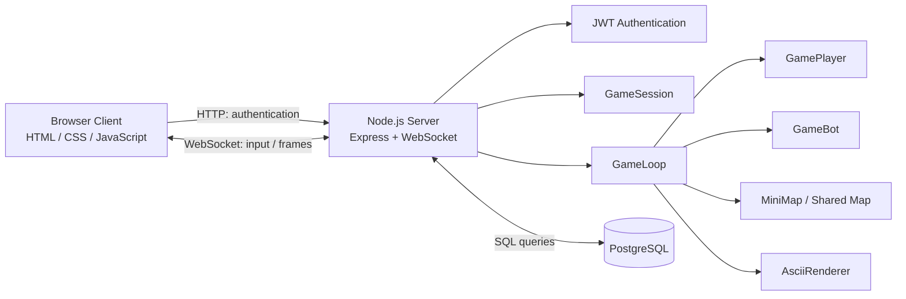

# Shooter — ASCII Multiplayer FPS

A real-time ASCII first-person shooter built with Node.js, TypeScript, Express, WebSockets, and PostgreSQL. Features multiplayer sessions, raycasting-based rendering, randomly generated maps, weapon combat, moving bots, JWT authentication, and persistent player state.

This project is a Node.js/TypeScript port of the original [Shooter C# project](https://github.com/paveldsh1/Shooter).

---

# English

## Features

- **WebSocket multiplayer** — multiple players share the same game world.
- **ASCII raycasting renderer** — first-person perspective, wall depth calculations, enemy sprites, weapon overlays, and minimap.
- **Random map generation** — connected walkable areas and wall collision detection.
- **Player movement** — forward/backward movement and rotation.
- **Weapon system** — pistol and shotgun with different cooldowns, damage, range, and hit angles.
- **Combat system** — server-side hit detection with distance, aiming-angle, and wall-occlusion checks.
- **Health and respawning** — players take damage, die, and respawn after a delay.
- **Moving bots** — AI-controlled opponents that move around the map and can be shot.
- **Bot mode toggle** — press `9` to enable or disable the bot mode.
- **Minimap and help overlay** — toggle the minimap with `M` and help with `Enter`.
- **JWT authentication** — authenticated WebSocket connections.
- **PostgreSQL persistence** — player data and game state are stored in a relational database.
- **Browser client** — HTML, CSS, and vanilla JavaScript; no frontend framework is required.

## Tech Stack

| Component | Technology |
|---|---|
| Runtime | Node.js |
| Language | TypeScript |
| HTTP server | Express |
| Real-time communication | WebSocket (`ws`) |
| Database | PostgreSQL |
| Database access | `pg`, direct SQL queries, no ORM |
| Authentication | JSON Web Tokens (JWT) |
| Frontend | HTML, CSS, vanilla JavaScript |
| Package manager | Yarn 4 |
| Database runtime | Docker (optional) |

## Gameplay

The game renders a first-person ASCII view in the browser. The server manages player movement, collision detection, weapon cooldowns, hit detection, health, bots, and respawning.

Players can connect to the same world and see other connected players in real time. Shooting is processed on the server, and walls block shots.

When a player dies, the server schedules a respawn after three seconds. The player's health is restored on respawn. Player state can be persisted in PostgreSQL and restored on a subsequent connection.

Bot mode adds moving AI-controlled opponents. Bots navigate walkable areas, have health, can be shot, and respawn after being killed. They do not attack players.

## Controls

| Key | Action |
|---|---|
| `W` | Move forward |
| `S` | Move backward |
| `A` | Turn left |
| `D` | Turn right |
| `Space` | Shoot |
| `1` | Select pistol |
| `2` | Select shotgun |
| `9` | Toggle bot mode |
| `M` | Toggle minimap |
| `Enter` | Toggle help overlay |

## Weapons

### Pistol
- Faster firing rate.
- Longer effective range.
- Narrower hit angle.
- Damage per hit: `25`.

### Shotgun
- Longer firing cooldown.
- Shorter effective range.
- Wider hit angle.
- Damage per hit: `15`.

The server checks the target's distance and angle relative to the shooter and verifies that no wall blocks the shot.

## Architecture



## Backend Modules

- `src/server.ts` — server entry point, HTTP/WebSocket setup, authentication integration, database interaction, and player connection lifecycle.
- `src/game/game-session.ts` — per-connection game state, keyboard input, viewport settings, selected weapon, and interface toggles.
- `src/game/game-loop.ts` — periodic game updates, rendering, combat, hit detection, and player/bot respawning.
- `src/game/player.ts` — player position, movement, collision handling, health, damage, and respawning.
- `src/game/bot.ts` — bot health, movement, target selection, and respawning.
- `src/game/mini-map.ts` — random map generation, connectivity checks, walkability, spawn selection, and minimap utilities.
- `src/game/ascii-renderer.ts` — raycasting, wall depth buffer, player rendering, minimap, weapon overlay, and help text.
- `src/game/enemy-sprites.ts` — ASCII enemy sprites selected according to distance.
- `src/game/weapon-sprites.ts` — weapon sprites and weapon types.
- `public/index.html` — browser client, authentication UI, keyboard input, WebSocket connection, and frame display.

## Game Loop and Rendering

The game loop runs approximately every `50 ms`, targeting around **20 frames per second**.

Each frame:
1. Updates active bots.
2. Iterates through connected WebSocket sessions.
3. Collects snapshots of other living players and active bots.
4. Raycasts the map to calculate wall distances.
5. Renders enemies, the minimap, the selected weapon, and help overlays.
6. Sends the resulting ASCII frame to the client as a binary WebSocket message.

The client sends keyboard commands to the server, while the server remains responsible for the authoritative game state and combat calculations.

## WebSocket Protocol

### Client → Server

The browser sends keyboard event codes such as:

- `KeyW`, `KeyA`, `KeyS`, `KeyD`
- `Space`
- `Digit1`, `Digit2`, `Digit9`
- `KeyM`
- `Enter`

The client also sends viewport updates in the following format:

```text
RESIZE {columns} {rows} {scale}
```

### Server → Client

The server sends rendered ASCII frames as binary WebSocket messages. The browser displays the received frames in the game interface.

The WebSocket connection uses the authentication protocol configured by the client and server.

## Database and Persistence

PostgreSQL stores player-related data and saved game state.

The application uses the `pg` package and direct SQL queries instead of an ORM. The database schema includes the `players` and `player_states` tables.

Persistence allows a player's saved position and orientation to be restored when the player reconnects, provided that the saved state is available and loaded successfully.

Database connection settings and authentication secrets are configured through environment variables.

## Security

- JWT-based authentication.
- Server-side game state and combat processing.
- Database credentials stored in environment variables.
- No database ORM required.

For public deployment, configure a strong JWT secret, use HTTPS/WSS, restrict database access, validate incoming requests, and avoid committing secrets to the repository.

## Design Principles

- **Separation of concerns** — player logic, bot logic, rendering, session management, and persistence are kept in separate modules.
- **Server-authoritative gameplay** — movement and combat state are processed on the server.
- **Shared world** — connected players and bots use the same map and rendering pipeline.
- **Direct SQL access** — database operations are performed without an ORM.
- **Typed contracts** — TypeScript types define game actions, viewport settings, and weapon types.
- **Lightweight client** — vanilla JavaScript communicates with the backend over HTTP and WebSocket.

## Project Structure

```text
Shooter-Node-Express-TS-PostgresSQL-/
├── public/
│   └── index.html
├── src/
│   ├── game/
│   │   ├── ascii-renderer.ts
│   │   ├── bot.ts
│   │   ├── enemy-sprites.ts
│   │   ├── game-loop.ts
│   │   ├── game-session.ts
│   │   ├── mini-map.ts
│   │   ├── player.ts
│   │   └── weapon-sprites.ts
│   └── server.ts
├── package.json
├── tsconfig.json
├── yarn.lock
├── .env
└── README.md
```

This tree lists the main game modules. Additional configuration and database-related files may exist in the repository.

## Requirements

- Node.js 20 or later.
- Yarn 4.
- PostgreSQL, either locally installed or running in Docker.
- Git.

## Running Locally

### 1. Clone the repository

```bash
git clone https://github.com/paveldsh1/Shooter-Node-Express-TS-PostgresSQL-.git
cd Shooter-Node-Express-TS-PostgresSQL-
```

### 2. Install dependencies

```bash
yarn install
```

### 3. Configure PostgreSQL

Create a PostgreSQL database and user, then configure the connection details in the environment variables expected by the application.

The development setup uses the following database settings:

- Database: `player_state`
- User: `app`
- Port: `5432`

The database schema includes the `players` and `player_states` tables.

### 4. Configure environment variables

Create a `.env` file in the project root and configure the database connection, server port, and JWT secret according to the server configuration.

Example:

```dotenv
PORT=3000
JWT_SECRET=replace_with_a_secure_random_secret
```

Add the PostgreSQL environment variables required by the application.

Generate a strong random JWT secret before running the application. Do not commit `.env` or real credentials to Git.

### 5. Check TypeScript

```bash
yarn tsc --noEmit
```

### 6. Start the application

Run the development or production command defined in `package.json`. For example, if a `dev` script is configured:

```bash
yarn dev
```

Open the local server URL configured by the application in your browser.

## Related Project

The original C# implementation is available here:

[**Shooter — C# / .NET**](https://github.com/paveldsh1/Shooter)

This repository ports the core ASCII FPS gameplay to Node.js and TypeScript, using PostgreSQL for persistence and JWT for authentication.

## Future Improvements

- More advanced bot navigation and behaviour.
- Player kill/death statistics and scoreboard.
- Matchmaking, lobbies, and multiple game instances.
- Improved player status and combat UI.
- Automated tests for combat, collision detection, and persistence.
- Monitoring and structured logging.

---

# Русский

## Описание

**Shooter** — многопользовательский ASCII-шутер от первого лица, работающий в браузере. Это версия оригинального [Shooter на C#](https://github.com/paveldsh1/Shooter), перенесённая на Node.js и TypeScript.

Серверная часть построена на Express и WebSocket. PostgreSQL используется для хранения данных игроков и сохранённого игрового состояния, а JWT — для аутентификации.

Игроки могут перемещаться по общей случайно генерируемой карте, выбирать оружие, стрелять друг в друга и сражаться с ботами. Игровой мир отображается в виде ASCII-графики.

## Возможности

- **Мультиплеер через WebSocket** — несколько игроков находятся в общем игровом мире.
- **ASCII-рендеринг от первого лица** — raycasting стен, расчёт глубины, спрайты противников и оружия.
- **Генерация карты** — случайное размещение стен с проверкой связности проходимых областей.
- **Перемещение и коллизии** — движение по карте с проверкой столкновений.
- **Два вида оружия** — пистолет и дробовик с разными параметрами стрельбы.
- **Боевая система** — серверная проверка попаданий, дальности, угла прицеливания и стен между стрелком и целью.
- **Здоровье и возрождение** — получение урона, смерть и возрождение через три секунды.
- **Боты** — перемещающиеся по карте противники, по которым можно стрелять.
- **Переключение режима ботов** — клавиша `9` включает и выключает режим ботов.
- **Мини-карта и подсказки** — отображение карты и игрового управления.
- **JWT-аутентификация** — проверка авторизации игроков.
- **PostgreSQL** — хранение данных игроков и игрового состояния.
- **Браузерный клиент** — HTML, CSS и обычный JavaScript без frontend-фреймворка.

## Технологический стек

| Компонент | Технология |
|---|---|
| Серверная среда | Node.js |
| Язык | TypeScript |
| HTTP-сервер | Express |
| Обмен в реальном времени | WebSocket (`ws`) |
| База данных | PostgreSQL |
| Доступ к БД | `pg`, прямые SQL-запросы без ORM |
| Аутентификация | JWT |
| Клиент | HTML, CSS, vanilla JavaScript |
| Менеджер пакетов | Yarn 4 |
| Запуск БД | Docker (опционально) |

## Игровой процесс

Игра отображает мир от первого лица с помощью ASCII-графики. Сервер отвечает за движение, столкновения, стрельбу, здоровье, ботов и возрождение.

Подключённые игроки видят друг друга в общей игровой сессии. Попадания рассчитываются на сервере, а стены блокируют выстрелы.

После смерти игрок возрождается через три секунды с восстановленным здоровьем. Сохранённое состояние может быть загружено из PostgreSQL при следующем подключении.

Боты перемещаются по проходимым участкам карты, имеют собственное здоровье, получают урон от выстрелов и возрождаются после гибели. Они не атакуют игроков.

## Управление

| Клавиша | Действие |
|---|---|
| `W` | Движение вперёд |
| `S` | Движение назад |
| `A` | Поворот влево |
| `D` | Поворот вправо |
| `Space` | Стрелять |
| `1` | Выбрать пистолет |
| `2` | Выбрать дробовик |
| `9` | Включить или выключить режим ботов |
| `M` | Показать или скрыть мини-карту |
| `Enter` | Показать или скрыть подсказки |

## Архитектура бэкенда

- `src/server.ts` — точка входа сервера, HTTP и WebSocket, аутентификация, подключение к базе данных и жизненный цикл подключения игрока.
- `src/game/game-session.ts` — состояние сессии, обработка клавиш, выбранное оружие, настройки окна и переключатели интерфейса.
- `src/game/game-loop.ts` — игровой цикл, обновление ботов, отрисовка, стрельба, проверка попаданий и возрождение.
- `src/game/player.ts` — позиция, движение, столкновения, здоровье, получение урона и возрождение игрока.
- `src/game/bot.ts` — движение ботов, выбор цели, здоровье и возрождение.
- `src/game/mini-map.ts` — генерация карты, проверка связности, проходимость клеток и выбор точек появления.
- `src/game/ascii-renderer.ts` — raycasting, буфер глубины, отображение противников, мини-карты, оружия и подсказок.
- `src/game/enemy-sprites.ts` — ASCII-спрайты противников.
- `src/game/weapon-sprites.ts` — спрайты оружия и типы оружия.
- `public/index.html` — браузерный клиент, интерфейс авторизации, клавиатурное управление и отображение игровых кадров.

## Игровой цикл и рендеринг

Игровой цикл выполняется примерно каждые `50 мс`, что соответствует целевой частоте около **20 кадров в секунду**.

Каждый цикл:
1. Обновляет движение активных ботов.
2. Обрабатывает подключённые WebSocket-сессии.
3. Получает данные о других живых игроках и активных ботах.
4. Выполняет raycasting и рассчитывает расстояния до стен.
5. Рисует противников, мини-карту, оружие и подсказки.
6. Отправляет ASCII-кадр клиенту через WebSocket в бинарном сообщении.

Сервер отвечает за игровое состояние и расчёт попаданий, а клиент отправляет команды управления и отображает полученные кадры.

## База данных и сохранение состояния

PostgreSQL используется для хранения данных игроков и их игрового состояния. Для работы с базой применяется пакет `pg` и прямые SQL-запросы без ORM.

В схеме используются таблицы `players` и `player_states`.

При повторном подключении сервер может восстановить сохранённые координаты и направление игрока, если сохранённое состояние доступно и успешно загружено.

Параметры подключения к базе данных и секрет JWT задаются через переменные окружения.

## Безопасность

- JWT для аутентификации.
- Обработка игрового состояния и стрельбы на сервере.
- Секреты и параметры подключения хранятся в переменных окружения.
- Прямой доступ к PostgreSQL без ORM.

Для публичного развёртывания необходимо настроить надёжный JWT-секрет, HTTPS/WSS, ограничить доступ к PostgreSQL и не публиковать `.env` в репозитории.

## Запуск

### Требования

- Node.js версии 20 или новее.
- Yarn 4.
- PostgreSQL или Docker.
- Git.

### 1. Клонирование

```bash
git clone https://github.com/paveldsh1/Shooter-Node-Express-TS-PostgresSQL-.git
cd Shooter-Node-Express-TS-PostgresSQL-
```

### 2. Установка зависимостей

```bash
yarn install
```

### 3. Настройка PostgreSQL

Создайте базу данных и пользователя, затем задайте параметры подключения в переменных окружения приложения.

В текущем окружении разработки используются:

- База данных: `player_state`
- Пользователь: `app`
- Порт: `5432`

Необходимые таблицы: `players` и `player_states`.

### 4. Переменные окружения

Создайте `.env` в корне проекта и укажите параметры сервера, подключения к PostgreSQL и JWT согласно конфигурации `src/server.ts`.

Пример:

```dotenv
PORT=3000
JWT_SECRET=replace_with_a_secure_random_secret
```

Добавьте переменные PostgreSQL, которые использует приложение. Перед запуском замените пример JWT-секрета на криптографически случайное значение. Не публикуйте `.env` в Git.

### 5. Проверка TypeScript

```bash
yarn tsc --noEmit
```

### 6. Запуск

Используйте команду, настроенную в `package.json`. Если проект содержит скрипт `dev`, запуск выполняется так:

```bash
yarn dev
```

Затем откройте в браузере локальный адрес, на котором работает сервер.

## Оригинальный проект

Исходная версия игры на C# доступна в репозитории:

[**Shooter — C# / .NET**](https://github.com/paveldsh1/Shooter)

Данный репозиторий переносит основные игровые механики на Node.js и TypeScript, добавляя PostgreSQL для хранения состояния и JWT для аутентификации.

## Возможные улучшения

- Более продвинутая навигация и поведение ботов.
- Таблица убийств и смертей игроков.
- Игровые комнаты и несколько игровых серверов.
- Улучшенный интерфейс здоровья и боевых показателей.
- Автоматизированные тесты для боя, коллизий и сохранения состояния.
- Метрики производительности и структурированное логирование.

